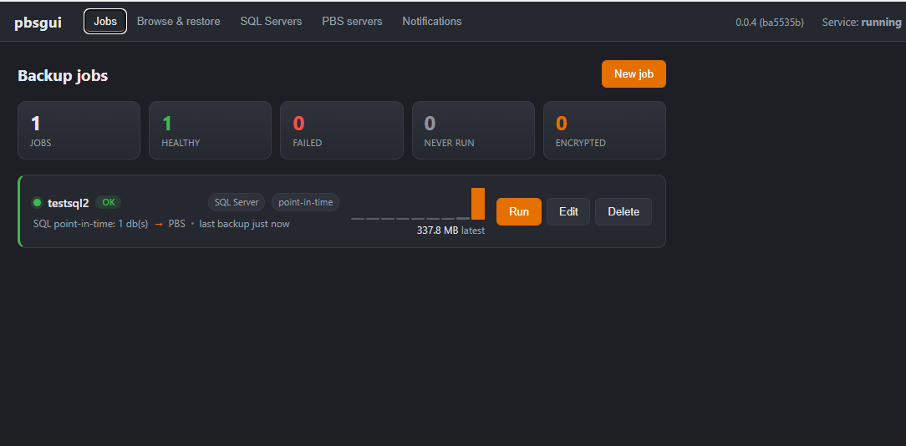
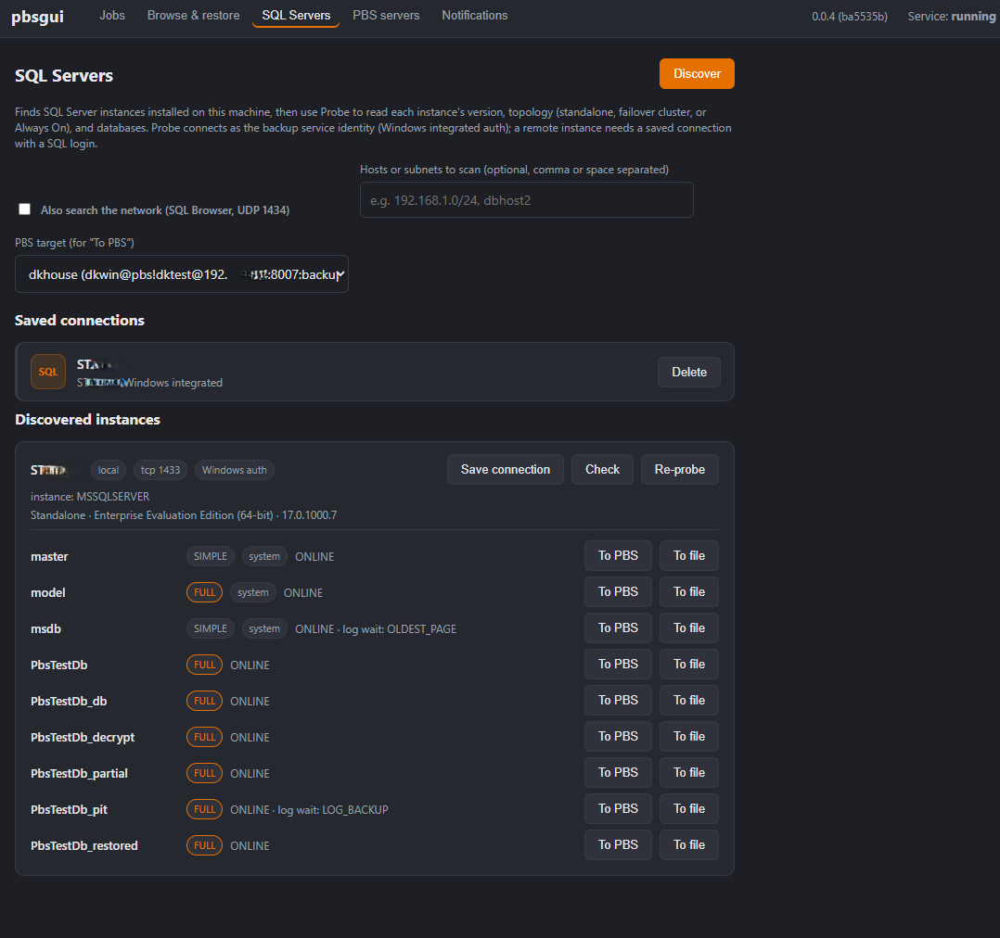
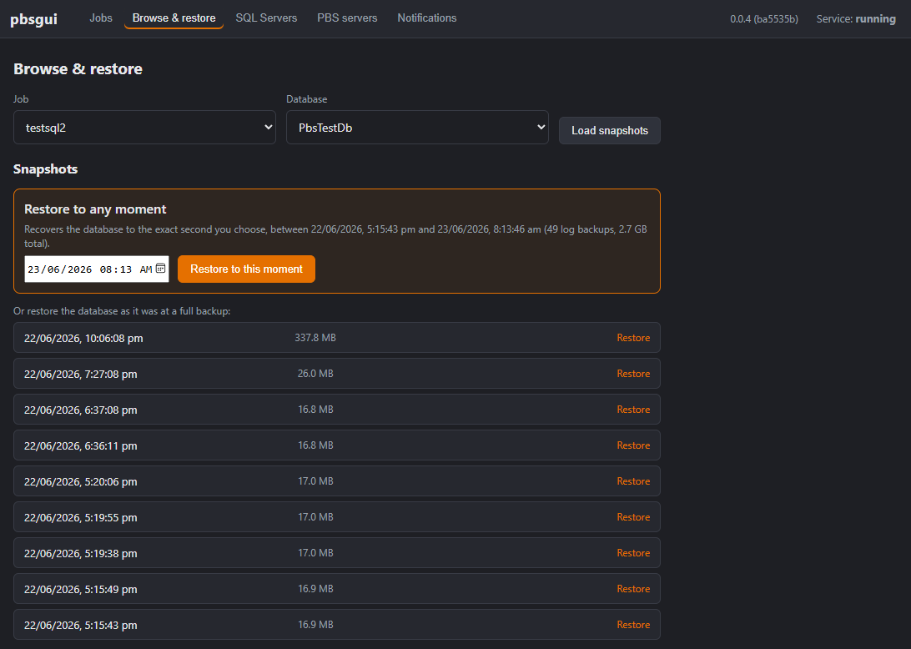
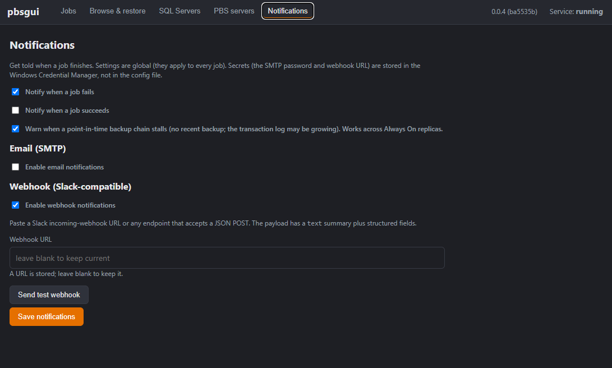
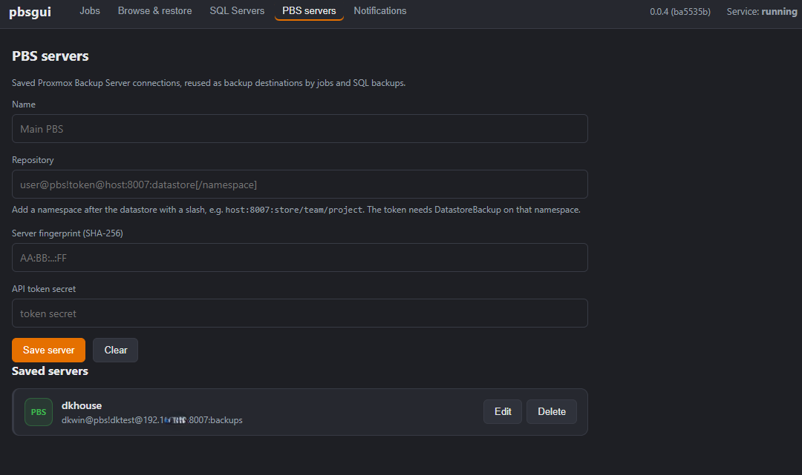

# pbsgui documentation

pbsgui backs up Windows machines and Microsoft SQL Server to a Proxmox Backup
Server (PBS). It runs as a native Windows app and service. It does full and
transaction-log SQL backups, browse, and restore to any point in time.

## Why this exists

The official Proxmox backup client is Linux-only and AGPL-licensed. It cannot run
on Windows. Its Rust crates are bound to the Unix file model, and its archive
format encodes Unix file semantics. So a Windows shop that runs PBS has no
first-party way to back up Windows or SQL Server to it.

pbsgui fills that gap. It reimplements the PBS backup protocol clean-room in Rust,
from the published protocol docs, so it runs natively on Windows and ships under
its own license (GPL-3.0). It is built for SQL Server, not bolted on: it streams
backups over the SQL Virtual Device Interface, manages the transaction-log chain,
handles Always On and Failover Cluster Instances, and restores to a chosen second.
It encrypts on the client, so the server never sees the key.

The other Windows GUI for PBS backs up files only. It does no SQL-aware backup and
no client-side encryption. Those are the reasons pbsgui exists.

## Backup topologies

pbsgui runs SQL backups two ways.

- **Local.** The engine runs on the SQL Server host and does everything there:
  reads the database over VDI, chunks, compresses, encrypts, and uploads to PBS.
  Simple, one machine per SQL Server. The backup CPU runs on the database server.
- **Relay.** A thin agent on the SQL Server host runs only the VDI device and
  streams the raw backup to a separate proxy machine. The proxy does the chunking,
  compression, encryption, and upload. The backup CPU moves off the database
  server. This is for fleets and for hosts that cannot spare cores during the
  backup window. See [RELAY.md](RELAY.md).

## Documentation index

| Doc | For | Contents |
| --- | --- | --- |
| [DEPLOYMENT.md](DEPLOYMENT.md) | Operators | Install and run pbsgui in production. Requirements, single-host setup, the first backup, upgrades. |
| [ALWAYS-ON.md](ALWAYS-ON.md) | Operators | Always On availability groups. What runs on which replica, the backup preference, log truncation and shrinking, and troubleshooting `LOG_BACKUP`. |
| [RELAY.md](RELAY.md) | Operators | Deploy relay mode. Topology, ports, credentials, the step-by-step proxy and agent setup, and troubleshooting. |
| [ARCHITECTURE.md](ARCHITECTURE.md) | Everyone | Components, the SQL backup strategy, the relay design, and the storage model. |
| [STATUS.md](STATUS.md) | Everyone | What works, what is in progress, and the roadmap. |
| [DEVELOPERS.md](DEVELOPERS.md) | Developers | Prerequisites, building the app and installer, and the dev loop. |
| [TESTING.md](TESTING.md) | Developers | Test tiers and the manual integration pass. |

## Start here

- Deploying to one SQL Server: read [DEPLOYMENT.md](DEPLOYMENT.md).
- Backing up an Always On availability group: read [DEPLOYMENT.md](DEPLOYMENT.md),
  then [ALWAYS-ON.md](ALWAYS-ON.md).
- Deploying a fleet, or offloading backup CPU: read [DEPLOYMENT.md](DEPLOYMENT.md),
  then [RELAY.md](RELAY.md).
- Building from source: read [DEVELOPERS.md](DEVELOPERS.md).

## Screenshots

| | |
| --- | --- |
|  |  |
| Jobs dashboard with status and size-over-time graphs | SQL Server discovery, connections, and databases |
|  |  |
| Browse and point-in-time restore | Notifications |
|  | |
| PBS servers | |

See [screenshots/README.md](screenshots/README.md) for how these are captured.

## Workspace layout

| Path | Purpose |
| --- | --- |
| `crates/pbs-client` | Clean-room PBS protocol client: sessions, blobs, indexes, chunking, REST. |
| `crates/pbsgui-ipc` | Shared GUI/engine message types and the local-socket transport. |
| `crates/pbsgui-engine` | The privileged engine: backup, scheduler, secrets, SQL, the relay, the service. |
| `src-tauri` | The Tauri desktop application (commands, tray, window behavior). |
| `ui/` | Static front end (HTML/CSS/JS) served by the Tauri app. |
| `docs/` | This documentation. |
